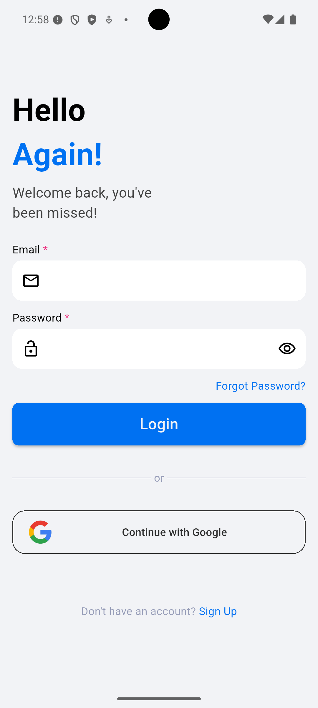
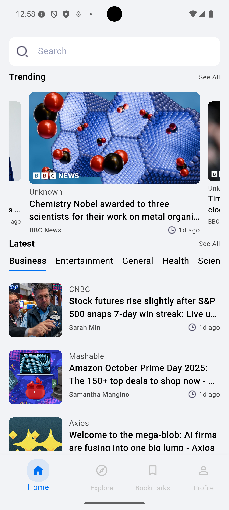
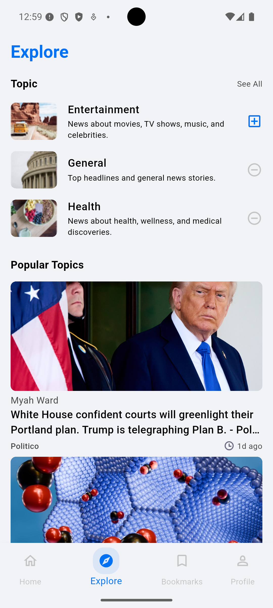
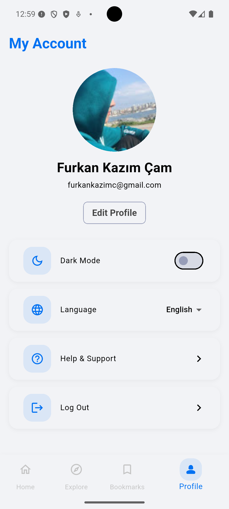
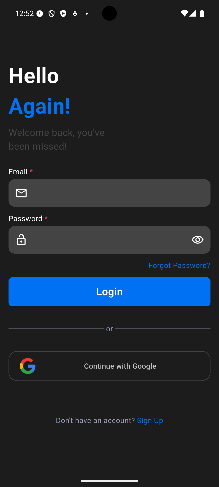
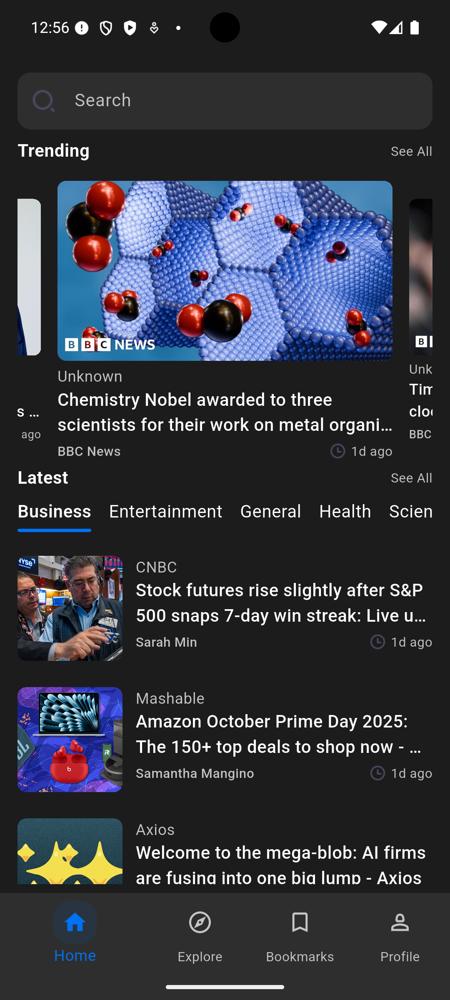
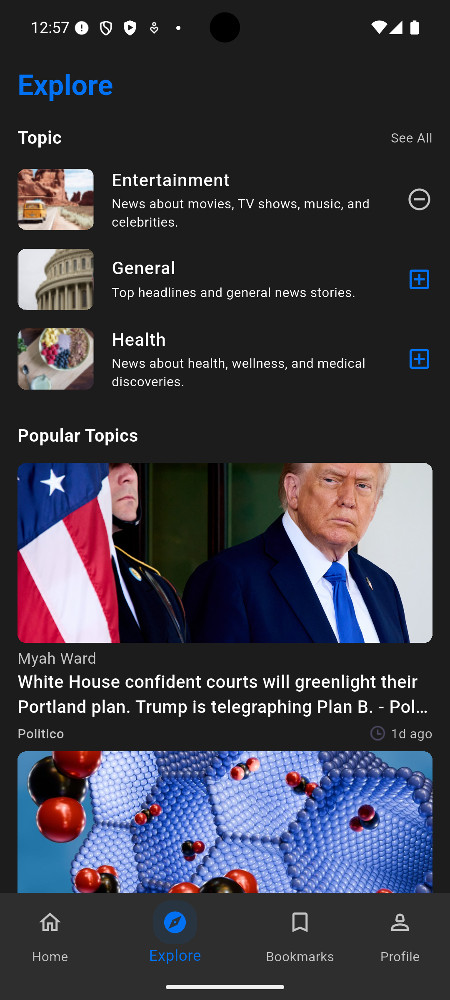
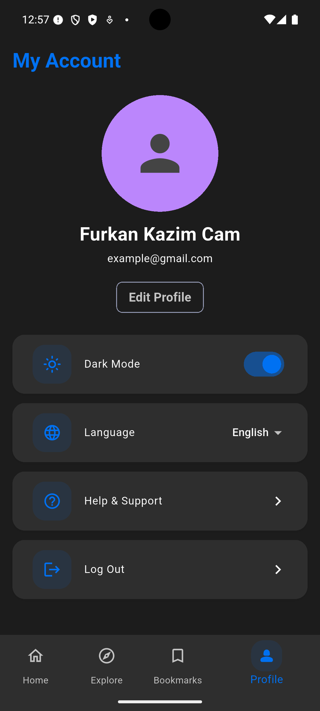

# Luci News 📰

[](https://flutter.dev)
 
[](https://dart.dev)

**Luci News** is a modern and fast mobile news application built with Flutter. Users can follow the latest news, filter by categories, and save their favorite articles.

## 📌 Features
- 📰 **Category-Based News:** Technology, Sports, Health, Economy, and more.  
- 🔍 **Search:** Quickly search news by title or content.  
- ⭐ **Favorites:** Add news to your favorites and save them.  
- 🌐 **Real-Time Data:** Fetch up-to-date news via REST API.  
- 📱 **Responsive UI:** Modern design compatible with both Android and iOS.  
- 🔒 **Firebase Integration:** User authentication and favorite news management.  

## 🛠 Technologies
- **Flutter & Dart** – Mobile app development  
- **REST API** – Fetch news data ([NewsAPI](https://newsapi.org))  
- **MobX** – State Management  
- **Firebase** – Authentication and Firestore

## ⚡ Installation

1. Set up your Flutter environment:  
   [Flutter Installation Guide](https://flutter.dev/docs/get-started/install)  

2. Clone the repository:
   ```bash
   git clone https://github.com/Furkanncm/newsapp.git
   cd newsapp

3. Install dependencies:
    ```bash
    flutter pub get

4. Run the app:
    ```bash
    flutter run


## 📱 Usage
* Navigate through categories and view the latest news.

* Tap on a news item to access full content and images.

* Favorited news can be viewed in a separate tab and will be saved.

* You can change the theme and language according to your preference.


## 🖼 Screenshots

| Login | Home | Explore | Profile |
|-------|--------|--------|--------|
|  |  |  |  |

| Login Dark | Home Dark | Explore Dark | Profile Dark |
|------------|------------|------------|------------|
|  |  |  |  |


## 🔗 API Information

* API: [NewsAPI](https://newsapi.org)

* Usage: Fetch data as JSON via REST API.

* Store your API key in a file at lib/.env.


## ✨ Contributors

* Furkan Kazım Çam – Lead Developer


## 🚀 Contact

* 📧 E-mail: [dev.furkankazimcam@gmail.com](mailto:dev.furkankazimcam@gmail.com)  
* GitHub: [github.com/Furkanncam](https://github.com/Furkanncam)
